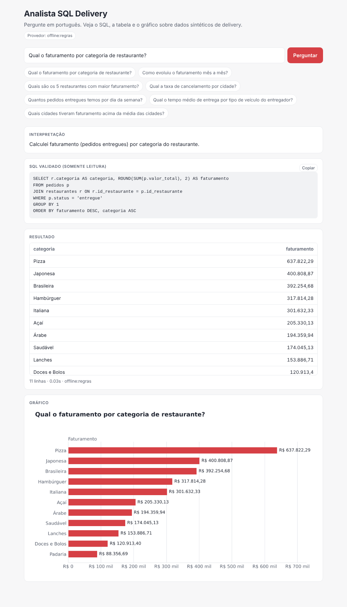
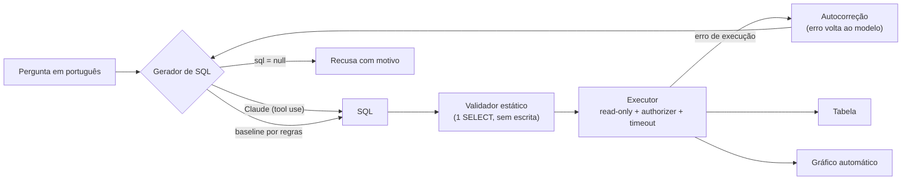

# analista-sql-delivery

Pergunte em português, receba **SQL validado**, **tabela** e **gráfico** sobre dados sintéticos de delivery
(restaurantes, pedidos, entregadores, avaliações). A qualidade é medida pela **acurácia por execução**: o SQL
gerado e o SQL de referência são rodados no mesmo banco e os *resultados* são comparados.



## Destaques

- **Texto → SQL com Claude** usando *tool use* forçado: a resposta já vem estruturada (SQL, explicação, tipo de gráfico ou recusa). O prompt carrega esquema, valores válidos (grafia exata de cidades, categorias etc.) e as **regras de negócio** (o que é faturamento, ticket médio, taxa de cancelamento).
- **Autocorreção**: se o SQL falha ao executar, o erro volta ao modelo, que tem até 3 tentativas.
- **Segurança em 3 camadas** para SQL vindo de um modelo: validação estática, conexão SQLite `mode=ro` e *authorizer* que nega tudo que não seja leitura (mais *timeout* e limite de linhas).
- **Recusa honesta**: pedidos de escrita, dados que não existem (CPF, telefone, lucro) ou previsões são recusados em vez de inventados.
- **Avaliação por execução** com 62 casos em 4 níveis, comparador tolerante (ignora nome/ordem de colunas, ordem de linhas quando não há ranking, arredondamentos) e relatório em Markdown.
- **Roda sem chave de API**: um baseline por regras permite usar e testar o projeto de ponta a ponta, e serve de ponto de comparação para o LLM.
- Interface web local (biblioteca padrão, sem dependências extras), CLI e biblioteca Python.

## Como funciona



| Módulo | Papel |
|---|---|
| `schema.py` | Esquema, dicionário de dados, regras de negócio e convenções de saída (fonte da verdade do prompt) |
| `synthetic.py` | Gerador determinístico dos dados sintéticos |
| `llm.py` | Gerador com Claude (tool use, *prompt caching* do esquema) |
| `offline.py` | Baseline por regras, sem LLM |
| `validador.py` / `executor.py` | Camadas de segurança e execução |
| `pipeline.py` | Orquestra geração → validação → execução → autocorreção |
| `graficos.py` | Escolha e desenho automático do gráfico |
| `avaliacao.py` | Comparação por execução e relatório |
| `web.py` / `cli.py` | Interfaces |

## Começando

Requer Python 3.10+.

```bash
git clone https://github.com/SEU-USUARIO/analista-sql-delivery.git
cd analista-sql-delivery
python -m venv .venv && source .venv/bin/activate     # Windows: .venv\Scripts\activate
pip install -e ".[dev]"

analista-sql gerar-dados                               # cria data/delivery.db (~30 mil pedidos, 1s)
analista-sql web                                       # abre http://127.0.0.1:8000
```

Sem chave de API o provedor `auto` usa o baseline por regras. Para usar o Claude:

```bash
pip install -e ".[claude]"
cp .env.example .env          # edite e coloque sua ANTHROPIC_API_KEY
analista-sql web              # agora o provedor é claude:<modelo>
```

O modelo padrão pode ser trocado com `ANALISTA_MODELO` no `.env`.

### Linha de comando

```bash
analista-sql perguntar "Qual o faturamento por categoria de restaurante?" --grafico saida.png
analista-sql perguntar --provedor offline "Top 5 restaurantes por faturamento"
```

### Como biblioteca

```python
from analista_sql.pipeline import Analista

analista = Analista.criar(provedor="auto")
res = analista.perguntar("Qual a taxa de cancelamento por cidade?")
print(res.sql)
print(res.colunas, res.linhas[:3])
open("grafico.png", "wb").write(analista.grafico_png(res))
```

## Dados sintéticos

Nada é real: restaurantes, clientes e pedidos são gerados por `synthetic.py` com semente fixa
(`--semente`, `--escala`), então todo mundo obtém exatamente o mesmo banco. Tabelas: `restaurantes`,
`clientes`, `entregadores`, `pedidos`, `itens_pedido`, `avaliacoes` (ano de 2025, 10 cidades, 11 categorias).

Os dados têm padrões plausíveis para que as perguntas tenham respostas interessantes: picos no almoço e no jantar,
fins de semana mais fortes, crescimento ao longo do ano, cancelamentos maiores em horário de pico, bicicleta mais
lenta que moto e **nota que cai com o atraso na entrega**. Os testes verificam a consistência (`valor_total` =
itens + taxa − desconto, avaliações só de pedidos entregues, pedidos só depois do cadastro do cliente etc.).

## Avaliação por execução

Comparar o texto do SQL engana: consultas muito diferentes podem responder igual e uma consulta quase idêntica pode
responder errado. Aqui cada caso de `evals/casos.json` tem um SQL de referência; os dois são **executados** e os
resultados comparados:

- nomes e ordem das colunas não importam; a ordem das linhas só importa em rankings (`ordenado: true`);
- números têm tolerância de 0,011 (arredondamento de 2 casas);
- coluna ou linha a mais/menos conta como erro;
- casos de **recusa** acertam quando o sistema recusa ou a camada de segurança barra o SQL.

São 62 casos: 13 fáceis, 25 médios (junções, agregações, datas, top N), 18 difíceis (subconsultas, CTEs, funções
de janela, `INTERSECT`, percentuais sobre o total) e 6 que **devem ser recusados**.

```bash
analista-sql avaliar --provedor offline    # baseline, sem chave
analista-sql avaliar --provedor claude     # gera evals/relatorio.md e evals/ultimo_resultado.json
```

### Resultado do baseline por regras (medido)

Relatório completo, com cada erro e o SQL gerado, em [`evals/relatorio_baseline_offline.md`](evals/relatorio_baseline_offline.md).

| Nível | Acertos | Taxa |
|---|---:|---:|
| Fácil | 11 / 13 | 84,6% |
| Médio | 22 / 25 | 88,0% |
| Difícil | 1 / 18 | 5,6% |
| **Acurácia por execução (56 respondíveis)** | **34 / 56** | **60,7%** |
| SQL executável sem erro | | 87,5% |
| Recusas corretas (6 casos) | 5 / 6 | 83,3% |

O baseline acerta o que cabe na sua gramática e falha onde é preciso raciocinar (subconsulta, janela, comparação com
a média). É exatamente onde se espera que o LLM ganhe. **O resultado com Claude depende da sua chave e do modelo**;
rode `analista-sql avaliar --provedor claude` e coloque aqui a tabela do seu `evals/relatorio.md`.

## Segurança

O SQL vem de um modelo de linguagem, então nunca é confiável. Defesa em profundidade:

1. **Validação estática** (`validador.py`): remove comentários, exige uma única instrução `SELECT`/`WITH` e bloqueia palavras de escrita/DDL (ignorando o que está dentro de strings).
2. **Banco aberto em modo somente leitura** (`file:...?mode=ro`).
3. ***Authorizer* do SQLite**: nega qualquer ação que não seja leitura, bloqueia as tabelas internas `sqlite_*` e funções como `load_extension`.
4. **Timeout** de 10 s e limite de 1000 linhas por resposta.

A interface web escuta só em `127.0.0.1` e não tem autenticação: é para uso local/demonstração.

## Testes

```bash
pytest
```

95 testes cobrem validador e executor (incluindo tentativas de injeção), integridade dos dados sintéticos,
comparador da avaliação, o caminho do Claude (com cliente simulado, sem rede), autocorreção, gráficos e a API web.
Os testes de mutação manuais (quebrar o validador ou o comparador) são detectados pela suíte.

## Limitações

- Dados sintéticos de um único ano e de um único esquema; não prova desempenho em um data warehouse real.
- A avaliação de 62 casos é pequena: serve para comparar versões do prompt/modelo, não para afirmar uma acurácia geral.
- Perguntas ambíguas dependem das regras de negócio do `schema.py` (ex.: "cidade" = cidade do restaurante).
- O baseline por regras é propositalmente simples.

## Licença

MIT. Veja [LICENSE](LICENSE).
